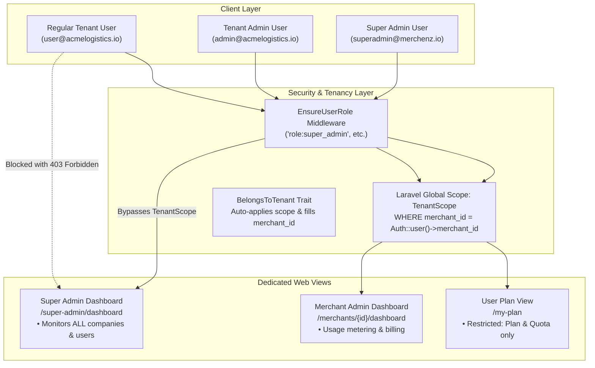

# MerchenZ — Multi-Tenant SaaS Usage Metering & Billing Engine

MerchenZ is an enterprise-grade Multi-Tenant SaaS usage metering, analytics, and billing platform built with Laravel 12 (PHP 8.2+). It combines **Single Database Row-Level Tenancy**, high-throughput **idempotent usage ingestion**, **prorated mid-cycle billing math**, **real-time metrics & churn risk analytics**, and a sleek **Dark / White UI** (Black & Red / Red & White combos).

---

## Table of Contents
1. [Architecture & Tenancy Model](#architecture--tenancy-model)
2. [Role-Based Access Control & Views](#role-based-access-control--views)
3. [Theme System (Dark & White Only)](#theme-system-dark--white-only)
4. [Onboarding & Registration Flow](#onboarding--registration-flow)
5. [Usage Ingestion & Rate-Limited API](#usage-ingestion--rate-limited-api)
6. [Billing Math & Proration Engine](#billing-math--proration-engine)
7. [Queued Background Jobs](#queued-background-jobs)
8. [Dashboard Metrics & Redis Caching](#dashboard-metrics--redis-caching)
9. [Database Schema & Partitioning](#database-schema--partitioning)
10. [Quick Start & Demo Credentials](#quick-start--demo-credentials)
11. [Automated Test Suite (66 Tests, 531 Assertions)](#automated-test-suite-66-tests-531-assertions)

---

## Architecture & Tenancy Model

MerchenZ implements **Single Database with Row-Level Tenancy**. All data lives in one central database where all tenant-specific tables have a `merchant_id` foreign key.



### 1. `TenantScope` (Global Eloquent Scope)
- Located at [`app/Scopes/TenantScope.php`](app/Scopes/TenantScope.php).
- Automatically appends `WHERE merchant_id = ?` to all model queries for authenticated tenant users (`admin` and `user`).
- **Super Admin Bypass:** If `Auth::user()->isSuperAdmin()` returns true, `TenantScope` is automatically bypassed so Super Admins monitor global platform health.
- **Explicit Scoping & Bypass:** Provides `TenantScope::forTenant($merchantId, $callback)` and `TenantScope::withoutTenancy($callback)`.

### 2. `BelongsToTenant` Model Trait
- Located at [`app/Traits/BelongsToTenant.php`](app/Traits/BelongsToTenant.php).
- Applied across all tenant models: [`Plan`](app/Models/Plan.php), [`Customer`](app/Models/Customer.php), [`UsageEvent`](app/Models/UsageEvent.php), [`Subscription`](app/Models/Subscription.php), [`DailyUsageAggregation`](app/Models/DailyUsageAggregation.php), and [`Invoice`](app/Models/Invoice.php).
- Automatically fills `merchant_id` on model creation from the authenticated tenant user or related model.

---

## Role-Based Access Control & Views

The application implements a 3-tier role hierarchy enforced by the [`EnsureUserRole`](app/Http/Middleware/EnsureUserRole.php) middleware:

| Role | Role Constant | Default Landing Route | Access Scope & Permissions |
| :--- | :--- | :--- | :--- |
| **Super Admin** | `User::ROLE_SUPER_ADMIN` | `/super-admin/dashboard` | **Global Platform Control**: Monitors all companies, total platform MRR, all usage events, and **all users' data**. Bypasses `TenantScope`. |
| **Tenant Admin** | `User::ROLE_ADMIN` | `/merchants/{id}/dashboard` | **Company Management**: Manages tenant usage analytics, customer metering, mid-cycle subscription changes, invoices, and team. |
| **Tenant User** | `User::ROLE_USER` | `/my-plan` | **Plan & Quota Only**: Restricted strictly to viewing their assigned plan details, included allowance, progress bar, and remaining quota. Direct access to `/super-admin/dashboard` is aborted with **403 Forbidden**. |

### Role-Based Redirection on Login
When users sign in via [`/login`](app/Http/Controllers/AuthController.php), the application inspects their role and redirects immediately:
- `super_admin` $\to$ `/super-admin/dashboard`
- `admin` $\to$ `/merchants/{id}/dashboard`
- `user` $\to$ `/my-plan`

---

## Theme System (Dark & White Only)

The UI features a streamlined, high-contrast visual theme system with strict **Dark** and **White** toggle labels:

- **Dark Theme (Black & Red Combo)**: Deep charcoal/black base (`#09090c` / `#15151e`) with crimson red accents (`#ff334b`).
- **White Theme (Red & White Combo)**: Crisp white base (`#fcfcfd` / `#ffffff`) with vivid red accents (`#dc2626`).
- **UI Labeling**: The switcher renders strictly as:
  ```html
  <div class="theme-switcher">
      <button type="button" class="theme-btn active" id="btn-theme-dark">Dark</button>
      <button type="button" class="theme-btn" id="btn-theme-light">White</button>
  </div>
  ```
- **Persistence**: Managed through `localStorage.getItem('merchenz_theme')` with zero-flash inline head initialization script.

---

## Onboarding & Registration Flow

Accessible at [`/onboarding`](app/Http/Controllers/OnboardingController.php) (or `/register`):

1. **Company Details**: Company Name, Company Email, Phone Number, Billing Address.
2. **Admin Account**: Name, Work Email, Password.
3. **Plan Catalog Selection**:
   - **Starter Tier**: $49.00/mo (10,000 units included, $0.0500/unit overage)
   - **Growth Tier**: $149.00/mo (50,000 units included, $0.0200/unit overage)
   - **Enterprise Tier**: $499.00/mo (250,000 units included, $0.0050/unit overage)
4. **Automated Provisioning**:
   - Creates `Merchant` row in global database.
   - Registers `User` with `role = admin` and links `merchant_id`.
   - Attaches `Plan` and initializes active `Subscription`.
   - Logs the Admin in and redirects to their company dashboard.

---

## Usage Ingestion & Rate-Limited API

### `POST /api/usage`

The usage ingestion pipeline is built for high write throughput, strict deduplication, and minimal response latency:

- **Controller**: [`App\Http\Controllers\Api\UsageController`](app/Http/Controllers/Api/UsageController.php)
- **FormRequest**: [`App\Http\Requests\RecordUsageRequest`](app/Http/Requests/RecordUsageRequest.php) (validates `event_id`, `customer_id`, `units`, `event_type`, `timestamp`)
- **DTO**: [`App\DTOs\UsageEventDTO`](app/DTOs/UsageEventDTO.php) (strictly typed boundary object)
- **Action**: [`App\Actions\RecordUsageAction`](app/Actions/RecordUsageAction.php) (domain execution unit)
- **Rate Limiting**: Enforced via `RateLimiter` at **120 requests/minute** per API key or IP.
- **Idempotency Guarantee**: Backed by a DB-level `UNIQUE(event_id)` constraint. Retried requests with the same `event_id` return `200 OK` ("Duplicate event — already recorded.") without double-counting.
- **Fast Queue Ingestion**: Passing `?async=true` or header `X-Queue: true` returns `202 Accepted` in <5ms, dispatching insertion to [`RecordUsageJob`](app/Jobs/RecordUsageJob.php).

#### Request Payload:
```json
{
    "customer_id": 1,
    "event_id": "evt_prod_01928374",
    "units": 10,
    "event_type": "api_query",
    "timestamp": "2026-11-02T12:00:00Z"
}
```

---

## Billing Math & Proration Engine

Located in [`App\Services\CalculateBillingService`](app/Services/CalculateBillingService.php):

### Critical Math & Split-Rate Proration
When a customer upgrades or downgrades mid-cycle:
1. The cycle timeline is split into discrete billing segments based on `subscription_changes`.
2. Usage occurring **before** the change is billed at the old plan's rate.
3. Usage occurring **after** the change is billed at the new plan's rate.
4. Base price and included allowance are prorated down to the exact day count:

$$\text{Proration Factor} = \frac{\text{Segment Days}}{\text{Total Cycle Days}}$$

$$\text{Prorated Base Price} = \text{Plan Base Price} \times \text{Proration Factor}$$

$$\text{Prorated Allowance} = \lfloor \text{Included Units} \times \text{Proration Factor} \rfloor$$

$$\text{Overage Units} = \max(0, \text{Segment Usage} - \text{Prorated Allowance})$$

$$\text{Overage Amount} = \text{Overage Units} \times \text{Plan Overage Rate}$$

---

## Queued Background Jobs

1. **`AggregateDailyUsageJob`** ([`app/Jobs/AggregateDailyUsageJob.php`](app/Jobs/AggregateDailyUsageJob.php)):
   - Runs nightly.
   - Chunks raw `usage_events` in batches of **5,000 rows**.
   - Aggregates units by `customer_id` and date, performing idempotent `UPSERT` into `daily_usage_aggregations`.
2. **`GenerateCycleInvoicesJob`** ([`app/Jobs/GenerateCycleInvoicesJob.php`](app/Jobs/GenerateCycleInvoicesJob.php)):
   - Runs at the end of customer billing cycles.
   - Invokes `CalculateBillingService` to calculate base amounts, proration splits, and overage charges, generating finalized `invoices` and `invoice_line_items`.

---

## Dashboard Metrics & Redis Caching

Managed by [`App\Services\DashboardMetricsService`](app/Services/DashboardMetricsService.php):

- **Current Cycle Usage vs. Allowance**: Compares aggregated cycle usage against tenant plan allowances.
- **Top 5 Customers by Usage**: Identifies highest consuming tenant customers with percentage breakdowns.
- **Projected Overage Revenue**: Linear run-rate projection of overage fees through cycle end.
- **Churn Risk Detection**: Automatically flags customers whose usage dropped **>50% Month-over-Month**.
- **Redis Cache & Invalidation**:
  - Plan pricing and quota lookups are cached with a 10-minute TTL.
  - [`App\Observers\PlanObserver`](app/Observers/PlanObserver.php) automatically invalidates the Redis/Cache key immediately when any `Plan` price or unit allowance is modified.

---

## Database Schema & Partitioning

```
merchants ──< plans ──< subscriptions >── customers
    │           │             │                │
    │           │    subscription_changes      │
    │           │             │                │
    │           │         invoices ──< invoice_line_items
    │           │             │
    └───> usage_events ───────┴───> daily_usage_aggregations
```

| Table | Tenant Key | Key Constraints & Indexes | Purpose |
| :--- | :--- | :--- | :--- |
| `merchants` | `id` | PK, UNIQUE(`email`), INDEX(`api_key`) | Tenant company entity |
| `users` | `merchant_id` | PK, UNIQUE(`email`), INDEX(`merchant_id`), INDEX(`role`) | Super Admin, Tenant Admin, User accounts |
| `plans` | `merchant_id` | PK, INDEX(`merchant_id`), INDEX(`is_active`) | Subscription tier definitions |
| `customers` | `merchant_id` | PK, INDEX(`merchant_id`), UNIQUE(`merchant_id`, `email`) | Customers belonging to a tenant |
| `subscriptions` | `merchant_id` | PK, INDEX(`merchant_id`), INDEX(`customer_id`, `status`) | Active subscriptions and renewals |
| `subscription_changes` | - | PK, FK(`subscription_id`), INDEX(`changed_at`) | Audit log for mid-cycle plan changes |
| `usage_events` | `merchant_id` | PK, **UNIQUE(`event_id`)**, INDEX(`merchant_id`), INDEX(`customer_id`, `recorded_at`) | Ingested usage events log |
| `daily_usage_aggregations` | `merchant_id` | PK, UNIQUE(`customer_id`, `usage_date`), INDEX(`merchant_id`) | 5k-chunked daily usage rollups |
| `invoices` | `merchant_id` | PK, INDEX(`merchant_id`), INDEX(`customer_id`, `period_start`) | Invoiced cycle bills |
| `invoice_line_items` | - | PK, FK(`invoice_id`), FK(`plan_id`) | Prorated billing segment lines |

---

## Quick Start & Demo Credentials

### Installation

```bash
# Clone and enter workspace
git clone <repo-url>
cd merchenz

# Install PHP dependencies
composer install

# Environment configuration
cp .env.example .env
php artisan key:generate

# Run migrations and seed multi-tenant demo data
touch database/database.sqlite
php artisan migrate
php artisan db:seed --class=MultiTenantSeeder

# Start local server
php artisan serve
```

### Pre-Seeded Demo Accounts

| Role | Email | Password | Landing Page |
| :--- | :--- | :--- | :--- |
| **Super Admin** | `superadmin@merchenz.io` | `password` | [`/super-admin/dashboard`](http://localhost:8000/super-admin/dashboard) |
| **Tenant Admin** | `admin@acmelogistics.io` | `password` | [`/merchants/1/dashboard`](http://localhost:8000/merchants/1/dashboard) |
| **Tenant User** | `user@acmelogistics.io` | `password` | [`/my-plan`](http://localhost:8000/my-plan) |

---

## Laravel Sanctum API & Postman Testing Guide

The API is fully authenticated via **Laravel Sanctum** using Bearer tokens, providing clean JSON endpoints for Postman testing.

### 1. Authentication Endpoints

#### Register as Tenant / Admin (`POST /api/register` or `POST /api/auth/register`):
```json
{
    "name": "Sarah Connor",
    "email": "admin@cyberdyne.io",
    "password": "password1234",
    "company_name": "Cyberdyne Systems",
    "phone": "+1 555 0199"
}
```
**Response (201 Created):**
```json
{
    "message": "Registration successful",
    "token": "1|AbCdEf123456789...",
    "token_type": "Bearer",
    "user": { "id": 2, "name": "Sarah Connor", "email": "admin@cyberdyne.io", "role": "admin", "merchant_id": 2 },
    "merchant": { "id": 2, "company_name": "Cyberdyne Systems", "api_key": "mk_..." }
}
```

#### Login (`POST /api/login` or `POST /api/auth/login`):
```json
{
    "email": "admin@cyberdyne.io",
    "password": "password1234"
}
```
**Response (200 OK):**
```json
{
    "message": "Login successful",
    "token": "2|XyZ987654321...",
    "token_type": "Bearer",
    "user": { "id": 2, "name": "Sarah Connor", "email": "admin@cyberdyne.io", "role": "admin", "merchant_id": 2 },
    "role": "admin",
    "merchant_id": 2
}
```

#### Authenticated Profile (`GET /api/user` or `GET /api/auth/me`):
- Header: `Authorization: Bearer <token>`
- Returns user profile, tenant company info, and assigned plan tier.

#### Logout (`POST /api/logout`):
- Header: `Authorization: Bearer <token>`
- Revokes token immediately from database.

---

### 2. Personas & Core Workflows

#### A. Admin / Merchant (Tenant) Persona
The tenant defines pricing tiers and inspects customer usage:
- **Define Subscription Plan** (`POST /api/plans`):
  ```json
  {
      "name": "High-Throughput Tier",
      "base_price": 299.00,
      "included_units": 100000,
      "overage_rate_per_unit": 0.0150,
      "billing_cycle_days": 30
  }
  ```
- **Update Plan Pricing** (`PUT /api/plans/{id}`):
  - Updates base price or overage rates, automatically triggering `PlanObserver` Redis cache invalidation.
- **View Dashboard Metrics (JSON)** (`GET /api/merchants/{id}/dashboard` or `GET /api/dashboard/metrics`):
  - Returns current cycle usage vs allowance, Top 5 customers by usage, projected overage revenue, and MoM churn risk (>50% drop).

#### B. User / Customer Persona
Subscribes to a merchant's plan and generates usage events:
- **Subscribe to Plan** (`POST /api/subscriptions`):
  ```json
  {
      "customer_id": 1,
      "plan_id": 2
  }
  ```
- **Generate Metered Usage** (`POST /api/usage`):
  ```json
  {
      "customer_id": 1,
      "event_id": "evt_live_001928",
      "units": 50,
      "event_type": "api_request"
  }
  ```
  - Rate-limited to 120 req/min, strictly idempotent on `event_id`.

---

## Background Processing: Queued Jobs & Prorated Invoices

Instead of real-time query bottlenecks upon user login, usage ingestion is decoupled into background processing:

### 1. `AggregateDailyUsageJob` (Nightly Rollup)
- Processes raw `usage_events` in chunks of **5,000 rows**.
- Aggregates usage units by `customer_id` and date, performing idempotent `UPSERT` into `daily_usage_aggregations`.
- **CLI Trigger**:
  ```bash
  php artisan usage:aggregate --date=2026-11-01
  ```

### 2. `GenerateCycleInvoicesJob` (Cycle-End Prorated Billing)
- Runs at billing cycle end.
- Queries pre-aggregated daily summaries and executes [`CalculateBillingService`](app/Services/CalculateBillingService.php) to calculate:
  - Prorated base prices across mid-cycle changes.
  - Split-rate usage segment math before/after plan changes.
  - Bounded overage amounts at plan-specific rates.
- Generates itemized `invoices` and `invoice_line_items`, and sets subscription status to `expired`.
- **CLI Trigger**:
  ```bash
  php artisan billing:generate-invoices --subscription=1
  ```

---

## Custom Error & System Availability Pages

All error and availability pages share the responsive **Dark** (Black & Red) and **White** (Red & White) combo themes with strict "Dark" and "White" toggle buttons:

1. **`404 Not Found`** ([`resources/views/errors/404.blade.php`](resources/views/errors/404.blade.php)):
   - Triggered when an unmapped tenant endpoint or resource is requested.
   - Provides instant "Return to Dashboard", "Go Back", and quick navigation links.
2. **`403 Access Forbidden`** ([`resources/views/errors/403.blade.php`](resources/views/errors/403.blade.php)):
   - Triggered when a tenant user attempts to access elevated routes (e.g. Super Admin dashboard).
   - Details the platform's 3-tier role boundary (Super Admin vs. Tenant Admin vs. Tenant User) with dynamic redirect to `/my-plan` or switch account options.
3. **`503 Server Engine Unavailable`** ([`resources/views/errors/503.blade.php`](resources/views/errors/503.blade.php)):
   - Triggered when Laravel enters maintenance mode (`php artisan down`) or previewed via `/unavailable`.
   - Displays real-time diagnostic indicators (Ingestion API, Tenant DB, Queue Worker), auto-countdown reconnect loop, and terminal startup tips.
4. **Offline Fallback Page** ([`public/unavailable.html`](public/unavailable.html)):
   - Standalone, zero-PHP dependency page designed for when the local web server or PHP process is **not started** or unreachable behind a reverse proxy.
   - Includes automatic polling loop (`fetch('/')`) that immediately redirects once the server boots.

---

## Automated Test Suite (66 Tests, 531 Assertions)

Execute the complete automated test suite:

```bash
php artisan test
```

### Test Breakdown

- **`BillingServiceTest`** (8 tests):
  - Standard monthly cycle billing with no overage
  - Overage calculation on exceeding included units
  - Proration on mid-cycle subscription start
  - Mid-cycle upgrade with split billing
  - Mid-cycle downgrade
  - Zero usage scenario
  - Multiple plan changes within one cycle
  - Overage with mid-cycle plan switch
- **`CalculateBillingServiceTest`** (3 tests):
  - Standard monthly billing with no overage
  - Overage billing exceeding allowance
  - Mid-cycle upgrade proration with split rates and overage
- **`DashboardMetricsTest`** (6 tests):
  - Current cycle usage vs. allowance calculation
  - Top 5 customers by usage
  - Projected overage revenue calculation
  - Churn risk detection (>50% MoM drop)
  - API Controller JSON payload structure
  - Plan pricing Redis caching and `PlanObserver` cache invalidation
- **`DashboardTest`** (4 tests):
  - Dashboard analytics response format
  - Top 5 customer aggregation
  - Churn detection algorithm
  - Normal usage verification
- **`DatabaseSchemaAndModelsTest`** (7 tests):
  - Database schema integrity for all tables
  - Foreign key relations and tenant associations
  - Daily aggregations rollup schema
- **`ErrorPagesTest`** (4 tests):
  - 404 page rendering with custom theme
  - 403 page rendering when user is unauthorized
  - 503 unavailable page rendering
  - Static `public/unavailable.html` existence and offline polling logic
- **`ExampleTest`** (2 tests):
  - Root redirect
  - Dashboard rendering with Dark & White theme switcher
- **`RecordUsageApiTest`** (7 tests):
  - API usage event recording with `event_id` and units
  - Strict idempotency ignoring retries without double-counting
  - `RecordUsageRequest` validation
  - `UsageEventDTO` serialization
  - `RecordUsageAction` direct execution
  - Fast queue dispatching (`RecordUsageJob`)
  - Rate limiting enforcement (120 req/min)
- **`RowLevelTenancyAndAuthTest`** (7 tests):
  - Onboarding page rendering with Dark & White theme
  - Login page rendering with Dark & White theme
  - Onboarding registration of company, admin user, and plan attachment
  - `TenantScope` row-level isolation between different merchants
  - Super Admin bypassing `TenantScope` to view all platform data
  - Role-based login redirection (`super_admin`, `admin`, `user`)
  - Regular user restricted to plan viewing only (and 403 on Super Admin dashboard)
- **`SanctumApiAndRolesTest`** (5 tests):
  - API registration for Merchant Admin issuing Sanctum token
  - API login issuing Sanctum Bearer token and logout revocation
  - Admin / Merchant persona defining and updating plans with pricing cache
  - User / Customer persona subscribing to plans and generating usage events
  - Queued chunked background job (`AggregateDailyUsageJob`) aggregating daily usage and generating prorated cycle invoices (`GenerateCycleInvoicesJob`)
- **`UsageAndAggregationTest`** (8 tests):
  - Raw usage event insertion
  - Idempotent request handling
  - Nightly 5k-chunk aggregation job execution and idempotency
  - Multi-customer aggregation handling

```
Tests:    66 passed (531 assertions)
Duration: 3.50s
```
